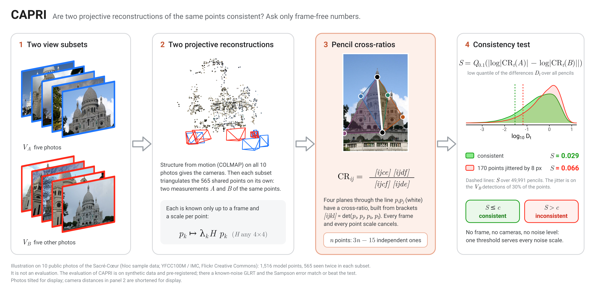

# CAPRI: Conditioning-Aware Projective Invariants

**Frame-free consistency checks for uncalibrated 3D reconstruction, built on pencils of planes.**

Two uncalibrated reconstructions of the same scene are each known only up to an unknown
projective frame and an unknown scale for every point, so their coordinates cannot be compared.
CAPRI compares them anyway: it measures how the cross-ratios of *pencils of planes* change between
the two, quantities that the frame and the scales cannot touch. This repository holds the
mathematics, its machine-checked proofs, the implementation, every experiment and every result.

**Author:** Kurt Andrei L. Gabriel, Navotas National Science High School  
**License:** Apache-2.0 (third-party components keep their own licenses; see [`DATA.md`](DATA.md))



---

## At a glance

| | Result | Evidence |
|---|---|---|
| **Geometry** | Every six-point invariant is a cross-ratio of a pencil of planes; every Grassmann-Plücker relation is λ + (1 − λ) = 1 on one pencil | Proofs in [`docs/MATHEMATICS.md`](docs/MATHEMATICS.md); SymPy, Macaulay2, Lean |
| **Completeness** | The pencil cross-ratios of *n* points have Jacobian rank exactly 3*n* − 15 where no bracket vanishes | Lean ([`formal/`](formal/)); exact rank over ℚ |
| **Statistic** | The low quantile of pencil discrepancies needs no frame, cameras or noise level, and is a first-order scale family | Lean; numerical checks with failure controls |
| **Conditioning** | κ_J ranks invariant noise error with Spearman 0.995 (smallest bracket: 0.844) | `kappa_conditioning_summary.csv` |
| **Simulation** | Separates excessive drift with AUC 0.984 (projective registration: 0.972); power 0.97–0.99 against injected inconsistency at 8 px | `pencil_drift_summary.csv`, `injection_*.csv` |
| **Real images** | On 23 IMC 2025 scenes the CAPRI layer leaves accuracy unchanged (mAA@10 difference −0.0027, 95% CI [−0.0082, 0.0020]) | `real_reconstruction_decision.csv` |
| **Open problem** | The null depends on the scene: no statistic kept its false-alarm rate in the pre-registered band on held-out real scenes (1.7–47.4%; standardized statistic nearest, 6.7%) | `real_pencil_size_ci.csv` |

All confirmatory studies were pre-registered ([`docs/prereg/`](docs/prereg/)); each records its
deviations. Negative and inconclusive results are reported as such.

---

## Verify it yourself

```bash
git clone --recurse-submodules https://github.com/gabpogi25/capri-stf && cd capri-stf
pip install -r requirements.txt

python -m pytest -q          # 201 tests, including the exact math-lock checks
make symbolic                # exact Plücker, pencil and rank identities (SymPy; Macaulay2 if installed)
bash formal/check.sh         # Lean 4 + Mathlib: every proof builds, and 23 deliberately false variants are rejected
make experiments             # rerun every simulation -> experiments/results/*.csv
make figures                 # redraw every figure from the result files -> figures/
```

Every number comes from a file in [`experiments/results/`](experiments/results/), and each file
records its seed, backend and code version in its header. Every data figure is drawn by
[`figures/make_figures.R`](figures/make_figures.R) from those files; nothing is typed in by hand.
Full installation notes, including the optional C++ backend, PyTorch and COLMAP, are in
[`SETUP.md`](SETUP.md).

---

## The study in detail

- **Mathematics** (`docs/MATHEMATICS.md`). The six-point invariants J1-J3 are
  cross-ratios of pencils of planes, and every Grassmann-Plücker relation is the identity
  lambda + (1 - lambda) = 1 on one pencil. A residual built from these relations is therefore
  zero on any single reconstruction, so consistency is judged *between* two reconstructions.
  The pencil cross-ratios of n points have Jacobian rank exactly 3n - 15 for every n. A
  consistency statistic (the 10% quantile of log-cross-ratio differences) needs no frame,
  cameras or noise level; it is a first-order scale family whose low quantile follows the
  harmonic mean of the per-pencil scales. The conditioning score kappa_J has a two-sided noise
  law and grows like 1/d near the strata it sees; tuple selection has the (1 - 1/e) guarantee.
  Checked by exact and numerical scripts with failure controls and a mutation harness. Lean
  (`formal/`) proves the rank, separation, scale-family, noise-law, small-ball and rate
  results; the harmonic-mean result (Prop 4.3) keeps its written proof and the (1 - 1/e)
  selection guarantee is the classical greedy bound. `formal/README.md` lists the scope.
- **Simulation study** (pre-registered; `docs/prereg/`).
  - *Supported:* invariance; kappa_J as a predictor of noise error (Spearman 0.995,
    against 0.844 for L(S)); the pencil statistic as a frame-free test of drift
    (AUC 0.984, against 0.972 for projective registration) and of injected
    inconsistency (power 0.97-0.99 at 8 px).
  - *Against classical tests* (detector benchmark at the detectable dose, 0.5 px): a
    likelihood-ratio test given the true noise level and the Sampson error match or
    beat the pencil statistic on jitter and drift. On local warps and track swaps it is
    level with that test and ahead of the Sampson error.
  - *Combination* (`docs/prereg/consistency_test.md`): a Cauchy combination of the pencil
    statistic and the Sampson error keeps its size (4.25%) and is more powerful than the
    better of the two on warps (0.57 vs 0.48) and track swaps (0.95 vs 0.83).
  - *Limits:* the raw null of the pencil statistic depends on scene geometry (98% false
    alarms on a shifted scene; the standardized version 4.5%, a Tyler-frame version 97.5%);
    no statistic tolerates a misspecified noise level; at 1 px noise the size is 7.0%. The
    coplanarity score beats DEGENSAC in five of six point representations but not under affine
    representatives; the neural fusion
    predicts the majority class.
- **Real data** (IMC 2025 training set, all 23 scenes of at most 75 images; pre-registered in
  `docs/prereg/real_reconstruction.md` and `real_pencil.md`).
  - *Reconstruction:* the CAPRI layer after RANSAC leaves accuracy unchanged: mAA@10 0.6250
    vs 0.6277, paired difference -0.0027, 95% CI [-0.0082, 0.0020]; decision: no difference,
    equivalent within 0.01 (SIFT 0.3743, SuperGlue without filtering 0.6097).
  - *Pencil test between view subsets* (333 calibration and 534 test windows): none of the five
    test statistics kept its false-alarm rate in [3.5%, 6.5%] on held-out real scenes (pencil
    1.7%, standardized 6.7%, Sampson 12.5%, combination 7.3%, split GLRT 47.4%), so no power
    is reported; the combination is not supported. Scene-clustered intervals (descriptive):
    pencil [0.6%, 2.8%] and GLRT [34.9%, 63.7%] lie outside the band; the standardized
    statistic [2.6%, 13.0%] misses it through two scenes. Calibration across scenes is the open
    problem for every statistic tested.
  - *Runtime* (laptop: i5-12450H, RTX 3050 6 GB): pencil statistic 0.76 ms (n = 12) and about
    7 ms (n = 100-300); kappa_J for 10,000 tuples 3.4 ms; the CAPRI layer adds 2.7-4.5 s of filtering per scene
    (GPU run, two scenes); SuperGlue matching 5.1 s on the GPU against 66.4 s on the CPU (9 images).
- **Framing:** a mathematical modeling study: the model, what is proved about it, and which of
  its predictions hold, with 3D reconstruction as the application.
- **Practice:** every number is produced by code here, with its seed in each result file;
  confirmatory runs are pre-registered in `docs/prereg/`.

Every figure is produced here (`figures/`). The three graphical abstracts (overview, mathematics, computational
pipeline) are in [`figures/abstracts/`](figures/abstracts/). Their photo panels are an
illustration on ten public photos of the Sacré-Cœur, not an evaluation.

---

## Mathematics (as implemented)

**Brackets.** For homogeneous points p_i in R^4, [p_i p_j p_k p_l] = det(p_i, p_j, p_k, p_l).
Points are unit-normalised first (`algorithms/utils.py`).

**Invariants.** J1, J2, J3 are ratios of bracket products with equal weight in every
point. They are PGL(4)-invariant and algebraically independent
(`algorithms/invariants/six_point.py`).

**Pencil cross-ratios.** For a line p_i p_j and four more points,
CR = [ijce][ijdf] / ([ijcf][ijde]) is the cross-ratio of four planes through the line.
J1-J3 are special cases, and every Plücker relation is the identity
lambda + (1 - lambda) = 1 on one pencil (`docs/MATHEMATICS.md`, Theorem 2.5).

**Consistency test.** Comparing all pencil cross-ratios of two measurements, through the
10% quantile of their log-differences, gives the pencil statistic
(`algorithms/consistency/pencil.py`). The family is used in full for n <= 12 points
(41,580 values from 495 brackets) and sampled uniformly above that (50,000 pencils,
fixed seed). The pipeline applies it to the points shared by two pair reconstructions
(`cross_pair_pencil_consistency`) and ranks points by their median pencil discrepancy.

**Grassmann-Plücker relations and rho.** The 15 brackets of six points satisfy 15
three-term relations; all are checked exactly in `experiments/symbolic/`. The residual
rho(S) = max_k |Sigma_k| (`algorithms/syzygy/residual.py`) is identically zero when all
brackets come from one point set (Corollary 2.6). It is informative only when brackets
come from different measurements in a common chart
(`synthetic_data.generator.estimate_brackets_independently`). Its exact bound is
tau_exact(delta) = 3 eps (2 + eps) with eps = (1 + delta)^4 - 1 (`compute_drift_threshold`).

**Conditioning.** kappa_J = max_k |grad log J_k|, the first-order noise gain of the
invariants, is the default (`algorithms/conditioning/scores.py::compute_invariant_noise_gain`).
L(S) = 8 / delta_min(S)^2, with delta_min the smallest normalised bracket among the 15,
is available as an option; kappa_J <= 2 sqrt(2 L(S)) (Proposition 5.2). Neither score is
PGL(4)-invariant, so the pipeline computes them in Tyler's canonical frame
(`algorithms.utils.whiten_homogeneous_points`). The default threshold is the median
score over generic tuples (kappa_J about 36). `--conditioning_metric L` selects L(S).

**Selection.** Among tuples below the conditioning threshold, greedy maximum coverage
of the points (`algorithms/selection/coverage.py`), with the classical (1 - 1/e)
guarantee over the feasible set.

**Strata.** The stratum is the size of the largest coplanar subset of the six points
(rank classifier `classify_stratum_by_rank`); m coplanar points have codimension m - 3.

**Computation.** kappa_J and log-brackets have C++ kernels (`cpp_core/src/pencil.cpp`,
Eigen fixed-size 4x4, GIL released) with NumPy references that agree to 1e-9. The
mathematics is locked: `tests/test_math_lock.py` re-runs the exact checks.

---

## Follow-up experiments (pre-registered)

Pre-registered in `docs/prereg/consistency_test.md` (seeds 81.0e6-81.003e6; 3,000 simulated
windows); results in `experiments/results/consistency_test_*.csv`.

| Hypothesis | Result | Decision |
|---|---|---|
| H1: a Tyler-frame standardised statistic keeps its size on a shifted scene | size 97.5% | not supported (predicted) |
| H1b: the ACAT-standardised statistic keeps it (replication) | size 4.5% | supported |
| H2: the pencil statistic is less sensitive than the GLRT to a misspecified noise level | f = 0.75: 69% vs 98%; f = 1.5: 0% vs 0% | not supported (tie at f = 1.5) |
| H3: a Cauchy combination of the pencil statistic and the Sampson error keeps its size and is at least as powerful as the better one, and more on some type | size 4.25%; warps 0.57 vs 0.48, swaps 0.95 vs 0.83, jitter and drift 1.00 | supported |

Exploratory (not pre-registered): a statistic on the 3(n - 5) frame coordinates is fast but
much weaker than the pencil family (AUC 0.75-0.81 against 0.99 on the drift benchmark;
`experiments/results/frame_statistic_exploration_summary.csv`), confirmed on the
consistency_test windows (AUC 0.55-0.74).

---

## Real-data evaluation

| Run | Data | Runner | Result |
|---|---|---|---|
| Reconstruction with and without the CAPRI layer (`docs/prereg/real_reconstruction.md`) | IMC 2025, 23 scenes, 4 pipelines, 3 seeds | `experiments/run_real_world_baselines.py`, `experiments/eval/real_reconstruction_analysis.py` | No difference, equivalent within 0.01: difference -0.0027, 95% CI [-0.0082, 0.0020] (`real_reconstruction_decision.csv`) |
| Pencil test between view subsets (`docs/prereg/real_pencil.md`) | 333 calibration and 534 test windows (30 points, 6 views) | `experiments/run_real_pencil.py`, `experiments/eval/real_pencil_analysis.py` | No statistic in the size band (1.7-47.4%); no power reported; combination not supported (`real_pencil_decisions.csv`, `real_pencil_size_ci.csv`) |
| Runtime on the evaluation machine | Laptop, CPU and GPU | `run_pencil_runtime.py`, `run_runtime.py`, `experiments/run_real_runtime.py` | `pencil_runtime_local.csv`, `runtime_local.csv`, `real_runtime_cpu.csv`, `real_runtime_gpu.csv` |
| Forensic video, GenVideo (`docs/prereg/forensics_video.md`) | 4,000 authentic Youku clips vs 8,302 GenVideo-Val clips (12,302 in all); Gen2, MoonValley, Sora held out | `experiments/forensics/real_media_null.py`, `heldout_detection.py` | Gate A passed (3.63% of 413 pencil windows); gate B failed: AUC 0.85-0.90 but metadata-only AUC 0.997, so no content-based detection shown (`forensics/*_video_full*`) |
| Forensic video, FaceForensics++ (`docs/prereg/forensics_ffpp.md`) | 400 originals, 1,600 manipulated (c23), split by pair | same runners, frame statistic only (deviation 1) | Gate A passed (5.41% of 924 frame values); gate B failed: AUC 0.50-0.51 for all four methods, metadata-only AUC 0.571 > 0.55 (`forensics/*_video_ffpp_full*`) |
| Compression robustness | Still images | `experiments/forensics/compression_sweep.py` with `--manifest` | Not run |

---

## What is in this repository

| Part | What it does | Status |
|---|---|---|
| **3D reconstruction** (`algorithms/`, `pipeline/`, `reconstruction/`, `colmap_capri_automator.py`, `dashboard.py`) | Pencil cross-ratios and the six-point invariants, conditioning by kappa_J (C++ kernel), degeneracy strata, constrained max-coverage tuple selection, cross-pair pencil consistency; certifies triangulated matches before dense reconstruction. | Working end to end on simulated scenes (`tests/test_pipeline_e2e.py`). |
| **Forensics** (`forensics/`, `experiments/forensics/`, `configs/default.yaml`) | Single-image structural test (cross-fitted vanishing points, bend test), multi-view pencil test for video, empirical nulls, block-Fisher, CUSUM, calibration and metrics. | Validated on simulated fixtures (`make forensics-fixtures`). On real video (GenVideo, FaceForensics++; pre-registered) the nulls hold at 5% but no detection survives the metadata control: no forensic claim. The real-data runners read a data manifest (`data/manifests/README.md`). |

---

## Running CAPRI on your own photos

```bash
pip install -r requirements.txt
make cpp            # optional C++ backend (CAPRI_BACKEND=auto|python|cpp)
make test           # fast tests; `make test-all` adds the slow multi-view tests
make symbolic       # exact Plücker / codimension checks (sympy)
```

Run the 3D pipeline on your own photos (SIFT, projective triangulation, CAPRI):

```bash
python pipeline/main_pipeline.py --image_dir path/to/photos --output_dir outputs/run1
```

This writes `reconstruction.ply`, `points3d.npy`, `trust_scores.npy`,
`certificates.json` and `diagnostics.json`, plus one PLY per image pair under `pairs/`.

For SuperGlue matching and COLMAP reconstruction with a choice of match filter
(`none`, `ransac`, `ransac_capri`):

```bash
git submodule update --init SuperGluePretrainedNetwork
python colmap_capri_automator.py --image_dir path/to/photos --output_dir outputs/sg --mode ransac_capri
streamlit run dashboard.py
```

COLMAP is found through `$COLMAP_EXE`, then the Windows binary that `setup_env.ps1`
downloads into `colmap/` (not versioned), then `PATH`.

---

## Reproducing every result and figure

All numbers come from CSVs written by the commands below. Each CSV starts with a header
recording the seed and backend.

| Result | Command | Result file(s) |
|---|---|---|
| All 3D simulation experiments | `make experiments` (= `python experiments/run_all.py`) | `experiments/results/*.csv` |
| Symbolic verification | `python experiments/symbolic/verify_plucker.py`, `verify_pencil.py` | printed PASS/FAIL |
| Invariance | `python experiments/run_invariance.py` | `invariance.csv` |
| Stratification | `run_stratification.py` | `stratification_*.csv` |
| Conditioning and selection | `run_conditioning.py`, `run_kappa_conditioning.py`, `run_greedy_efficiency.py`, `run_tuple_count.py` | `conditioning_*.csv`, `kappa_conditioning*.csv`, `greedy_efficiency*.csv`, `tuple_count*.csv` |
| Plücker residual | `run_syzygy_residual.py` | `syzygy_residual.csv` |
| Drift admissibility and the frame-free test | `run_drift_admission.py`, `run_pencil_drift.py` | `drift_admission*.csv`, `pencil_drift*.csv` |
| Shape prior | `ml_models/shape_prior/` (PyTorch) | `shape_prior*.csv` |
| Confidence fusion | `run_fusion_metrics.py`, `run_logistic_fusion.py` | `fusion_*.csv`, `logistic_fusion_*.csv` |
| Ablation | `run_ablation.py` | `ablation.csv` |
| Trust calibration | `run_trust_calibration.py`, `run_trust_calibrated.py` | `trust_calibration*.csv`, `trust_calibrated_*.csv` |
| Degeneracy baselines and coplanarity score | `run_synthetic_baselines.py`, `run_degeneracy_matched.py` | `true_synthetic_baselines*.csv`, `degeneracy_matched_*.csv` |
| Evaluation of the consistency test: score audit, noise model, dose-response, null calibration, clip aggregation, detector benchmark, representation robustness, selection | `experiments/eval/score_audit.py` ... `selection_by_information.py` (pre-registered in `docs/prereg/evaluation_plan.md`) | `score_audit*.csv`, `noise_model*.csv`, `injection_*.csv`, `null_*.csv`, `clip_*.csv`, `detector_benchmark*.csv`, `coplanarity_robustness*.csv`, `selection_by_information*.csv` |
| Runtime | `run_runtime.py`, `run_pencil_runtime.py`, `experiments/run_real_runtime.py` | `runtime*.csv`, `pencil_runtime*.csv`, `real_runtime_*.csv` |
| Real-image reconstruction benchmark | `run_real_world_baselines.py`, `eval/real_reconstruction_analysis.py` (IMC data, hloc, pycolmap, COLMAP) | `real_world_baselines_batch1.csv`, `real_reconstruction_*.csv` |
| Pencil test on real scenes | `run_real_pencil.py`, `eval/real_pencil_analysis.py` | `real_pencil_*.csv` |
| Forensic fixtures | `make forensics-fixtures` | `experiments/results/forensics/*.csv` |
| Forensic real-data runs | `experiments/forensics/real_media_null.py`, `heldout_detection.py`, `compression_sweep.py` with `--manifest` | `experiments/results/forensics/real_media_null_*.json`, `heldout_detection_*.json`, `compression_sweep*` |
| **All figures and summary tables** | `make figures` (= `Rscript figures/make_figures.R`) | `figures/*.pdf`, `figures/*.png`, `figures/tables/*.csv` |
| Photo illustration for the abstracts (not an evaluation) | `run_abstract_photo_demo.py` (pycolmap) | `abstract_photo_*.csv` |
| Graphical abstracts | `make abstracts` (R assets + Inkscape layouts) | `figures/abstracts/*.pdf`, `*.png`, `*.svg` |

---

## Layout

```
algorithms/        invariants, pencil consistency, conditioning (kappa_J, L), syzygy residuals, strata, selection, backend selector
cpp_core/          optional pybind11 backend (same results as Python)
synthetic_data/    configuration generators, injection families, independent-estimation measurement model
pipeline/          end-to-end image -> certified reconstruction
reconstruction/    triangulation, certificates, visualisation
ml_models/         shape prior and confidence fusion (optional)
forensics/         forensic-consistency module (config, io, geometry, stats, eval, structure, video, fusion)
experiments/       one script per result; eval/ evaluation of the consistency test; forensics/ runners; symbolic/ exact checks
figures/           make_figures.R and its outputs; abstracts/ graphical abstracts (Inkscape + R)
configs/           parameter registry for the forensic study (pre-registered gates)
data/manifests/    manifest format and template (datasets are not included)
docs/              mathematics, literature log, pre-registrations
tests/             unit, property, math-lock, evaluation-harness and end-to-end tests
```

---

## Documentation

| Document | Contents |
|---|---|
| [`docs/MATHEMATICS.md`](docs/MATHEMATICS.md) | The mathematics with proofs and status labels |
| [`formal/`](formal/) | Lean 4 formalization (scope listed in `formal/README.md`) |
| [`docs/prereg/`](docs/prereg/) | Pre-registrations, each with its deviations |
| [`GOAL.md`](GOAL.md) | Accuracy targets and their status |
| [`SETUP.md`](SETUP.md), [`DATA.md`](DATA.md) | Installation; datasets and licenses |

---

## Data and licenses

The real-image and video datasets (IMC 2025, GenVideo, FaceForensics++) are not redistributed;
[`DATA.md`](DATA.md) explains how to obtain them under their own terms. SuperGlue and DUSt3R are
included as git submodules under their own licenses, and COLMAP is downloaded by `setup_env.ps1`
(Windows) or installed from a package manager. The code in this repository is released under
Apache-2.0.
